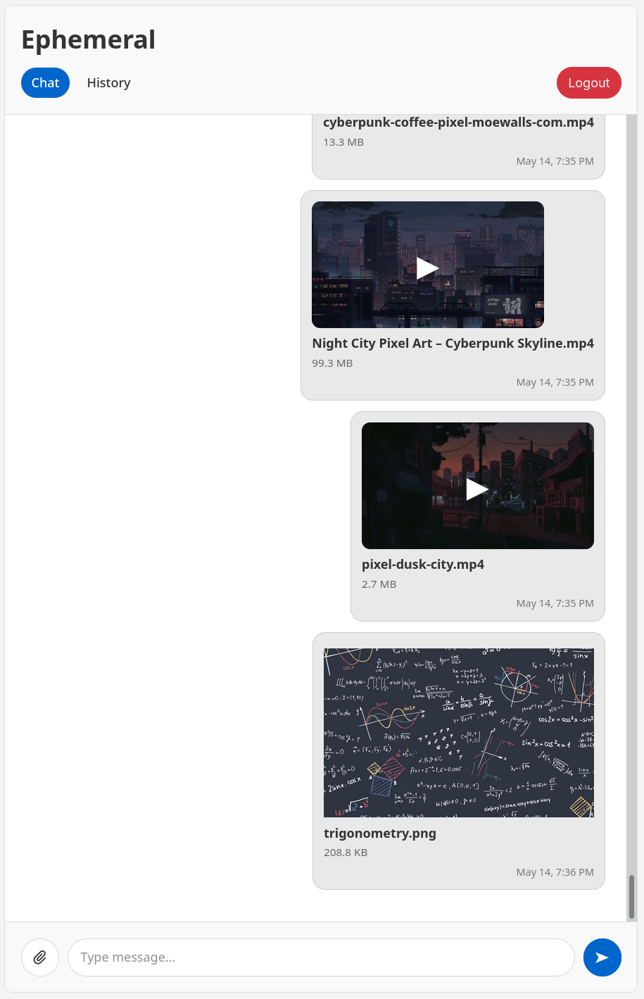
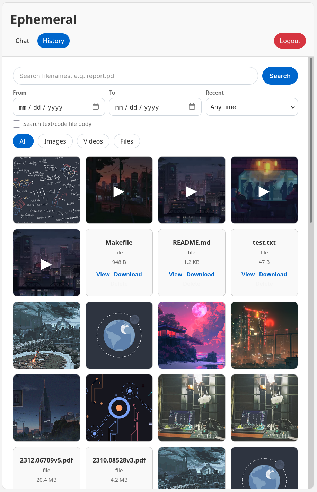

# Ephemeral

Ephemeral es una aplicación web ligera y autoalojada para compartir rápidamente mensajes de texto y archivos entre dispositivos.

<table>
  <tr>
    <td width="50%" align="center">
      
      <br />
      <sub>Página de chat</sub>
    </td>
    <td width="50%" align="center">
      
      <br />
      <sub>Página de historial</sub>
    </td>
  </tr>
</table>

## Tabla de contenidos

- [Ephemeral](#ephemeral)
- [Características](#features)
- [Tecnologías utilizadas](#tech-stack)
- [Requisitos (Solo para desarrollo)](#requirements-development-only)
- [Configuración](#configuration)
- [Despliegue con Docker](#docker-deployment)
- [Desarrollo](#development)
  - [Compilar y ejecutar localmente](#build-and-run-locally)
  - [Formateo y Lint](#format-and-lint)

## Características:

- Feed estilo chat
- Visor de medios de imagen y vídeo con vista previa de miniaturas y copias de reproducción de vídeo compatibles con el navegador
- Enlaces públicos a archivos con caducidad opcional
- Vista y descarga genérica de archivos
- Visor de archivos de código y texto con resaltado de sintaxis
- Modo de selección múltiple: selecciona varios elementos para realizar una eliminación en masa o descargarlos todos en un solo archivo ZIP
- Cola de progreso para la subida de archivos
- Búsqueda en el historial: filtros por tipo y fecha, nombre de archivo y búsqueda en el cuerpo de archivos de texto
- Paginación y desplazamiento infinito
- Actualizaciones reactivas en tiempo real mediante eventos enviados por el servidor (SSE)
- API JSON compatible con dispositivos móviles
- Persistencia de datos con SQLite
- Despliegue con Docker
- Desarrollo con recarga en caliente (hot-reload)

## Tecnologías utilizadas

- Go
- SQLite
- Vue 3
- TypeScript
- Vite
- HLS.js
- FFmpeg
- Docker y Docker Compose

## Requisitos (Solo para desarrollo)

```bash
go >= 1.21
node >= 20
npm
ffmpeg
air
```

## Configuración

Variables de entorno:

```env
PORT=8080
DATA_DIR=./data
SESSION_TTL=30d
COOKIE_SECURE=false
TRUSTED_PROXIES=
CHAT_PAGE_SIZE=100
HISTORY_PAGE_SIZE=100
SEARCH_RESULT_LIMIT=30
MAX_UPLOAD_SIZE=2GiB
TEXT_PREVIEW_MAX=10MiB
BODY_INDEX_MAX=20MiB
MEDIA_WORKER_COUNT=1
MEDIA_PROCESS_TIMEOUT=30m
HLS_MIN_SIZE=100MiB
HLS_MIN_DURATION=5m
UPLOAD_CONCURRENCY=1
```

Los valores de tamaño aceptan bytes o `KB`, `MB`, `GB`, `TB`, `KiB`, `MiB`, `GiB`, `TiB`.
Las cargas de vídeo se procesan de forma asíncrona con FFmpeg. El archivo original se conserva para su descarga, se genera una copia de reproducción MP4 faststart para la reproducción en el navegador y se genera HLS cuando se alcanza cualquiera de los umbrales `HLS_MIN_SIZE` o `HLS_MIN_DURATION`. La interfaz del navegador utiliza HLS nativo cuando está disponible, HLS.js cuando MediaSource está disponible y, de lo contrario, recurre a MP4. Establezca ambos umbrales de HLS en `0` para generar HLS para cada vídeo.
`UPLOAD_CONCURRENCY` está limitado a 10. Establezca `COOKIE_SECURE=true` cuando sirva únicamente a través de HTTPS. Establezca `TRUSTED_PROXIES` en IPs/CIDRs de proxy separadas por comas solo cuando un proxy inverso de confianza configure los encabezados de reenvío.

Crear archivo de entorno local:

```bash
cp .env.example .env
```

## Despliegue con Docker

Ejecutar con Docker Compose:

```bash
docker compose up -d --build
```

## Desarrollo

Instalar dependencias web:

```bash
make install-web
```

Ejecutar con recarga en caliente:

```bash
make dev
```

El comando de desarrollo inicia la API de Go en el puerto 8080 y Vite en el puerto 5173.
Ir a:

```text
http://localhost:5173
```

### Compilar y ejecutar localmente

Compilar:

```bash
make build
```

Ejecutar:

```bash
make run
```

Limpiar binario:

```bash
make clean
```

Eliminar datos locales de la aplicación:

```bash
make clean-data
```

### Formateo y Lint

Formatear:

```bash
make format
```

Verificar con Lint:

```bash
make lint
```

Corrección automática:

```bash
make fix
```
